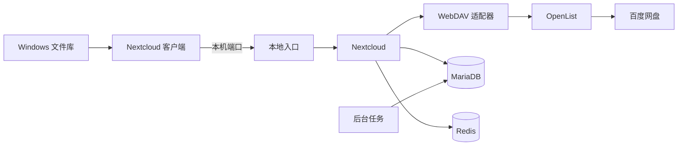

# BaiduDrive LocalLibrary

把百度网盘接入 Windows 原生文件库。

本项目组合 Nextcloud、OpenList 和 WebDAV 适配器。Windows 客户端提供文件占位符。打开在线文件时，客户端下载文件内容。

仓库提供适配器、隔离部署配置和 Windows 托管入口。

## 数据链路



Nextcloud 和后台任务连接 Docker 内部网络。适配器通过 OpenList 访问百度网盘。本地入口绑定 `127.0.0.1`。

## 核心能力

- 空文件使用已登记的标记文件保存。适配器对外呈现零字节内容。
- 适配器保存逻辑修改时间。
- 中断的写入保留恢复记录。
- 日常启动复用本地账号和专用客户端配置。
- 日常启动使用固定的本地镜像。镜像准备和升级由维护者主动执行。
- 初始化生成独立凭据。运行目录位于仓库之外。
- 各设备独立运行服务端，并通过百度目录共享空文件登记和逻辑修改时间。
- 提供控制窗口、自动本地配对和可选 PCS 备用下载。

## 开始使用

需要 Windows、PowerShell 7.4 或更高版本、Docker Desktop 和 Nextcloud 桌面客户端。Docker Desktop 必须使用 Linux 容器。

1. 克隆仓库。
2. 将 `.env.example` 复制为 `.env`。
3. 修改目录、账号名和端口。
4. 执行初始化。

```powershell
pwsh -File .\windows\Library.ps1 -Action Init
pwsh -File .\windows\Library.ps1 -Action Prepare
pwsh -File .\windows\Library.ps1 -Action StartServer
```

`Prepare` 是显式联网步骤。它下载固定镜像，并构建适配器。

接着按[部署步骤](docs/setup.md)配置 OpenList、外部存储和客户端。首次配对由脚本配置本地账号。新设备读取已发布的共享元数据。日常启动复用已保存的账号。

```powershell
pwsh -File .\windows\Library.ps1 -Action Start
pwsh -File .\windows\Library.ps1 -Action EnableStartup
```

## 文档

| 文档 | 内容 |
| --- | --- |
| [部署步骤](docs/setup.md) | 初始化、授权、外部存储和首次配对 |
| [日常操作](docs/operations.md) | 启动、停止、自启、备份和升级 |
| [配置说明](docs/configuration.md) | 配置字段、网络和静默设置 |
| [架构边界](docs/architecture.md) | 组件职责、状态和数据路径 |
| [多设备元数据](docs/multi-device.md) | 元数据共享、首次发布和恢复 |
| [备用下载](docs/downloads.md) | PCS 程序、授权和下载策略 |
| [故障处理](docs/troubleshooting.md) | 根据现象检查原因 |
| [中文写作规则](docs/writing-guide.md) | 固定术语和操作句规则 |
| [贡献说明](CONTRIBUTING.md) | 修改范围和发布前检查 |

## 使用条件

本项目面向本机文件库。服务端口保持绑定 `127.0.0.1`。

文件库是双向同步入口。删除和覆盖会传递到目标存储。请先使用独立目录验收。

文件操作遵循百度网盘、OpenList 驱动和上游客户端的规则。

整机防火墙保持部署者的策略。`ApplyPolicy` 统一专用客户端的文件名规则。客户端通过配置关闭更新检查。

参考部署已验证真实文件读取。通用版本的检查范围见[验证记录](docs/verification.md)。空白电脑上的完整配对仍需人工验收。

## 许可证

适配器、Windows 入口和中文说明采用 [MIT](LICENSE) 许可证。Nextcloud 容量扩展保留 AGPL 许可证。第三方组件遵守各自许可证。见[第三方说明](THIRD_PARTY_NOTICES.md)。

中文说明采用项目自定义的受控写法，规则见[中文写作规则](docs/writing-guide.md)。
